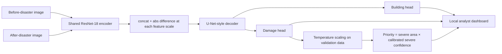

# ReliefLens — Calibrated Disaster-Damage Triage from Satellite Imagery

ReliefLens is a two-image, Siamese change-detection system for prioritizing post-disaster building damage for human review. It uses paired pre/post satellite imagery and xBD-style building polygons/damage labels rather than manually invented visual evidence.

**Safety/decision boundary:** ReliefLens is decision support. It does not replace analysts and should not make autonomous emergency-response decisions.

## What is implemented

- Event-disjoint xBD manifest creation
- Pixel-space polygon → semantic mask conversion
- Paired pre/post patch dataset with aligned augmentation
- Shared ResNet-18 Siamese encoder
- U-Net-style feature-difference decoder
- Building localization head
- Four-class damage head + background
- Focal + Dice/CE objective with class weighting
- Temperature-scaling calibration and expected calibration error
- Severe-damage review-priority ranking
- Building IoU/F1, damage macro/per-class F1, ECE, triage recall
- Best-checkpoint training and history artifacts
- Local Streamlit analyst dashboard
- Unit tests for data parsing, model shape, losses, metrics, calibration, inference, and triage ordering
- Streaming evaluation statistics to avoid retaining every test-pixel logit in RAM
- Configurable multiple random training crops per source image

## Dataset

The project targets xBD/xView2. The original xBD dataset provides paired pre/post 1024×1024 RGB satellite images and polygon building annotations; the challenge data is distributed through the xView2 site and requires the appropriate download/registration flow. The project expects the original pixel-space polygons in `features["xy"]`. 

Suggested layout after extraction:

```text
data/raw/xbd/
  train/
    images/
    labels/
  tier3/
    images/
    labels/
```

The implementation scans recursively, so `train` plus `tier3` or other supplied event folders can coexist under `data/raw/xbd`.

## Install

Use Python 3.10–3.13.

```bash
python -m venv .venv
# Windows
.venv\\Scripts\\activate
# Linux/macOS
source .venv/bin/activate
pip install -r requirements.txt
```

For a CUDA GPU, install the matching PyTorch build first if your platform needs a non-default CUDA wheel.

## Prepare manifests

Edit the disaster names in `configs/default.yaml`, then:

```bash
python -m src.data.prepare \
  --raw-root data/raw/xbd \
  --out-dir data/manifests \
  --config configs/default.yaml
```

This creates `train.csv`, `val.csv`, `test.csv`, and `summary.json`. The split is **event-level**, not random image-level. The strict check fails if a discovered disaster event is not explicitly assigned to a split.

## Train

The default model is the Siamese ReliefLensNet. A six-channel U-Net baseline is also included for a clean ablation:

```bash
python -m src.training.train --config configs/default.yaml --train-manifest data/manifests/train.csv --val-manifest data/manifests/val.csv --out-dir artifacts_baseline --model baseline
```


Laptop/CPU proof-of-pipeline:

```bash
python -m src.training.train \
  --config configs/default.yaml \
  --train-manifest data/manifests/train.csv \
  --val-manifest data/manifests/val.csv \
  --out-dir artifacts
```

The default configuration uses four random 256×256 crops per source image per epoch plus synchronized 90-degree rotations and flips. For a stronger experiment on free Kaggle/Colab GPU time, increase epochs and/or use 512×512 patches if memory permits. Validation/evaluation use deterministic exhaustive patches.

## Evaluate on an unseen event

```bash
python -m src.evaluation.evaluate \
  --config configs/default.yaml \
  --checkpoint artifacts/best.pt \
  --manifest data/manifests/test.csv \
  --out reports/metrics.json
```

Metrics include:

- building-mask IoU/F1
- damage macro F1
- per-class damage F1
- temperature chosen on validation data and ECE
- severe-damage pixel recall inside the top 10%, 20%, and 30% highest-priority tiles

Do not put placeholder numbers in the README or resume. Copy only values generated by your held-out evaluation run.

Calibration is fit only on the validation split after model selection and stored in `artifacts/calibration.json` / `best.pt`; the evaluator never learns temperature from the held-out test set.

## Dashboard

```bash
streamlit run src/dashboard/app.py
```

Upload the pre/post image pair and select `artifacts/best.pt`. The dashboard shows the images, predicted damage mask, class counts, triage priority, checkpoint provenance/hash, registration sanity checks, confidence/entropy-based abstention, analyst/time audit data, and human correction exports. It provides corrected PNG, CSV, pixel-space GeoJSON, and JSON audit exports. The GeoJSON is explicitly pixel-space and is not a substitute for a geographic CRS transform.

For a synthetic visual pair useful for testing the UI:

```bash
python -m src.dashboard.demo --out outputs/demo
```

## Tests

```bash
pytest
```

The test suite uses tiny synthetic xBD-style JSON/image fixtures and checks critical failure modes without requiring the real dataset, including duplicate-safe discovery, MultiPolygon preservation, unknown-label rejection, registration checks, uncertainty/abstention, and a self-contained CLI evaluation run. CI installs dependencies, compiles Python, runs Ruff, and runs the full pytest suite. The repository's validation log is in `docs/VALIDATION.md`.

## Architecture



## Engineering notes

1. **Building-first design:** the building head separates the localization problem from damage classification, reducing the chance that background texture is interpreted as damage.
2. **Event-level split:** same-disaster leakage can otherwise make results deceptively optimistic.
3. **Aligned augmentation:** every geometric transformation is applied identically to pre and post imagery.
4. **Unclassified labels:** xBD `un-classified` pixels are ignored by the damage loss/metrics rather than silently forcing them into a damage class; they still count as building pixels for localization.
5. **Calibration:** temperature scaling is fit only on validation logits and never on the test set.
6. **Triage metric:** top-k recall measures how much ground-truth severe-damage pixel mass is captured when an analyst reviews only the highest-priority tiles.

## Known limitations

- xBD imagery is already co-registered; materially misaligned real-world imagery can cause change false positives.
- The damage model is semantic segmentation. The dashboard derives building-level summaries from connected components of the building head; this is an instance-aware approximation, not a learned instance-segmentation head.
- Temperature scaling is global; per-disaster or class-conditional calibration may perform better with enough validation data.
- `pretrained: true` downloads ResNet weights on first model construction. Set it to `false` in offline environments.
- The Streamlit UI requires the declared `streamlit` dependency; the core model/data/evaluation code does not. The local audit environment may omit Streamlit, while CI validates the source and installed project dependencies.
- A real training/evaluation run requires the licensed/downloaded dataset; the repository intentionally does not bundle xBD imagery. Until a real event-disjoint xBD run is completed, no real-world performance claim should be attached to the project.

## Reproducibility

Record the generated `configs`, `history.json`, `best.pt`, `metrics.json`, exact disaster split, and Python/PyTorch versions with each experiment.

## Sources

- Gupta et al., “Creating xBD: A Dataset for Assessing Building Damage from Satellite Imagery,” CVPR Workshops 2019: https://openaccess.thecvf.com/content_CVPRW_2019/html/cv4gc/Gupta_Creating_xBD_A_Dataset_for_Assessing_Building_Damage_From_Satellite_CVPRW_2019_paper.html
- xView2 challenge: https://xview2.org/
